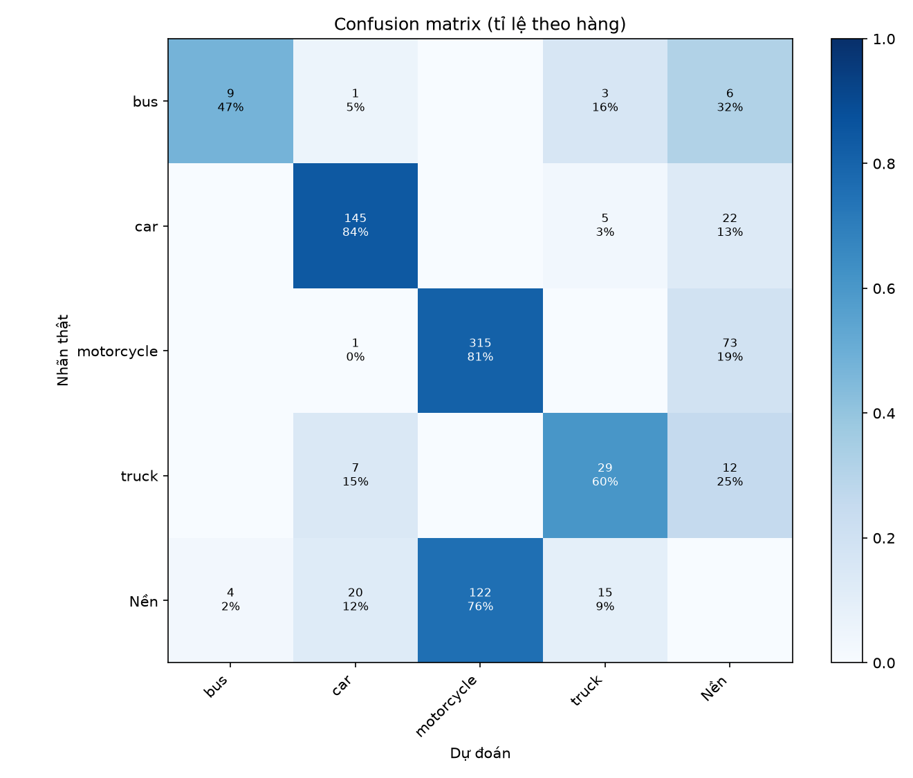
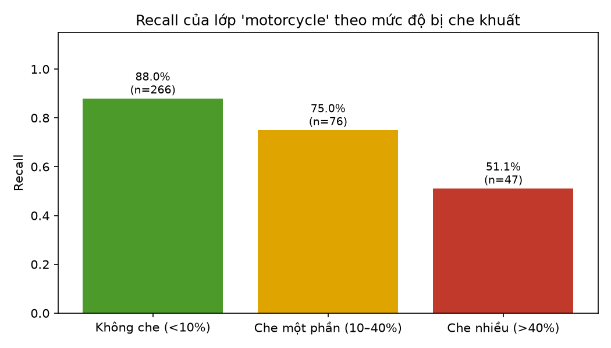
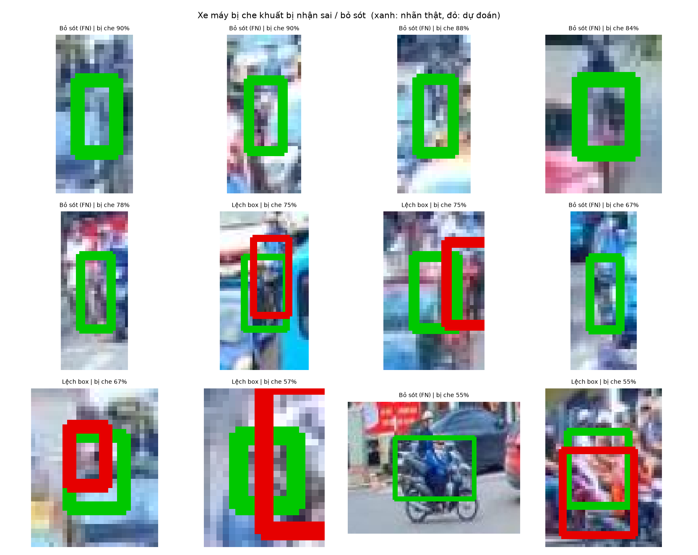
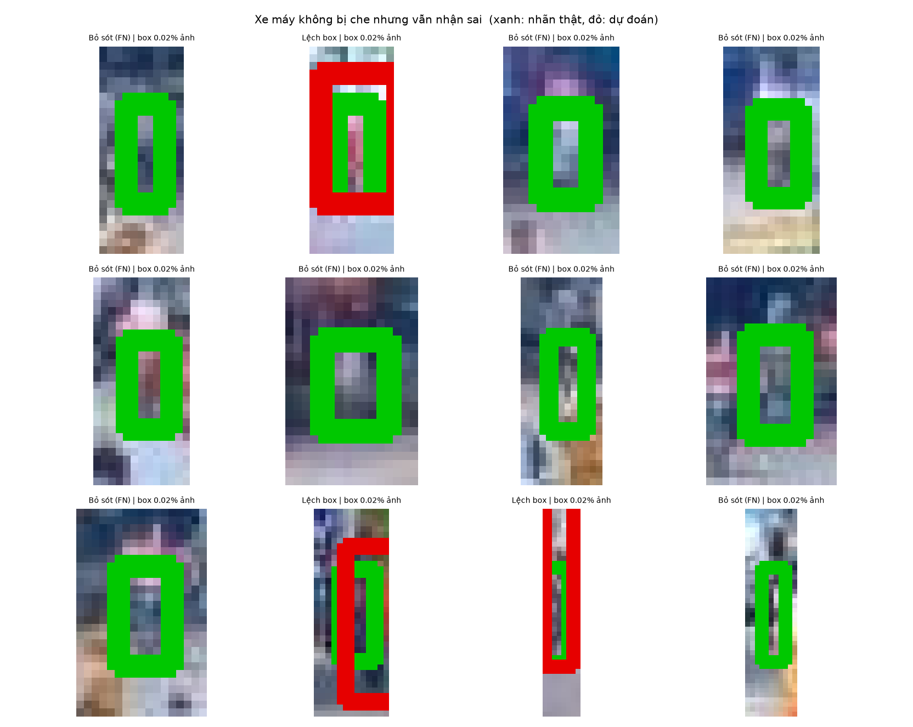
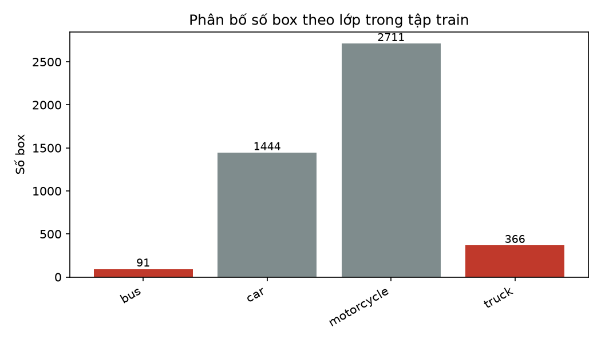
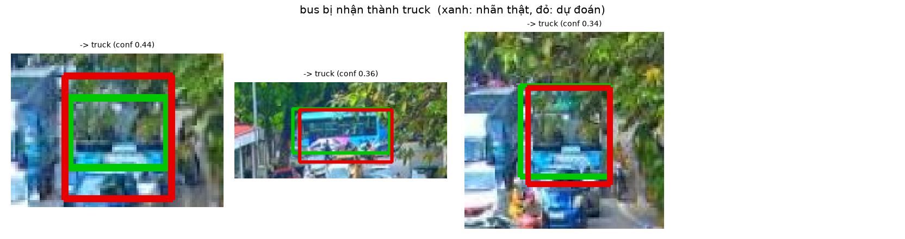
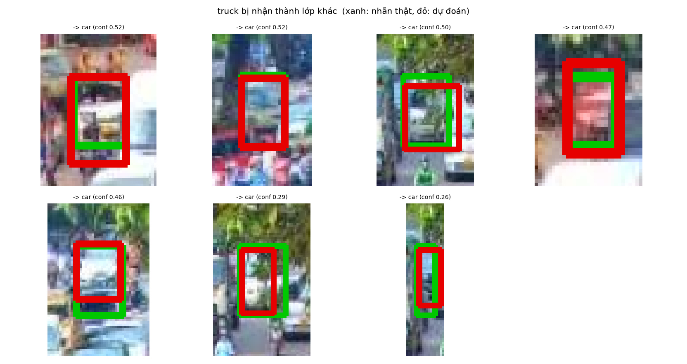
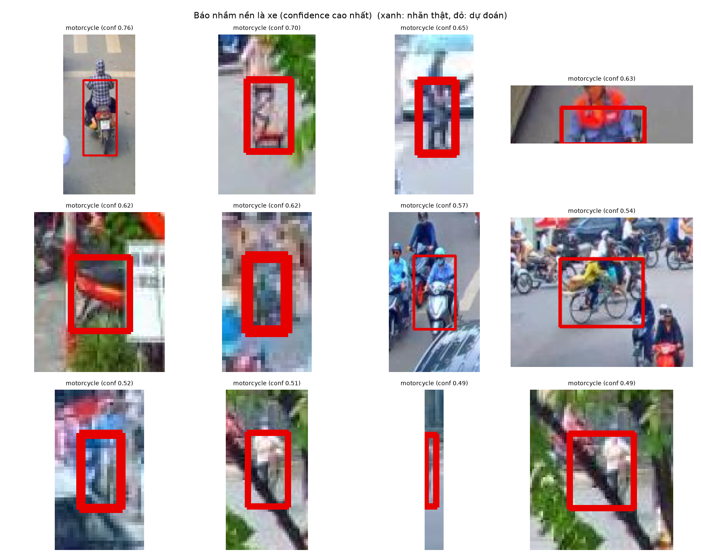

# BÁO CÁO TUẦN 6 – PHÂN TÍCH CÁC CA NHẬN DIỆN SAI (ERROR ANALYSIS)

- Người thực hiện: Đỗ Xuân Bách
- Ngày: 01/11/2026
- Model: YOLOv8n (best.pt), ngưỡng confidence 0.25
- Dữ liệu đánh giá: Roboflow projectdoan2 v1, tập test gồm 18 ảnh, 628 đối tượng, 4 lớp (bus, car, motorcycle, truck)

## 1. Mục tiêu

Tìm hiểu model đang sai ở đâu và vì sao, để định hướng cải thiện ở các tuần sau. Báo cáo tập trung vào hai nhóm lỗi chính: (1) xe máy bị che khuất trong cảnh giao thông đông đúc, (2) nhầm lẫn giữa xe buýt và xe tải.

## 2. Phương pháp

Chạy model trên toàn bộ tập test, sau đó ghép từng dự đoán với nhãn thật theo thứ tự confidence giảm dần và xếp mỗi đối tượng vào một trong các nhóm sau:

- Đúng (TP): cùng lớp, IoU ≥ 0.5.
- Nhầm lớp: box đúng vị trí (IoU ≥ 0.5) nhưng sai lớp.
- Lệch box: đúng lớp nhưng 0.1 ≤ IoU < 0.5.
- Bỏ sót (FN): không có dự đoán nào khớp.
- Với các dự đoán thừa: báo nhầm nền (không có xe), trùng lặp (hai box cho cùng một xe).

Mức độ che khuất: dataset không có nhãn che khuất, nên được ước lượng bằng tỉ lệ diện tích box bị các box khác đè lên. Chỉ tính các box có cạnh dưới thấp hơn trong ảnh (tức gần camera hơn). Chia thành 3 mức: không che (<10%), che một phần (10–40%), che nhiều (>40%).

Sau khi có số liệu, các ảnh failure case của từng nhóm lỗi được xem trực tiếp để tìm nguyên nhân (mục "Quan sát từ ảnh").

## 3. Kết quả tổng quan

Trên tập test, model đạt recall 79.3% và precision 73.7% (ngưỡng confidence 0.25, IoU 0.5). Lớp có recall thấp nhất là 'bus' (47.4%). Trong các đối tượng bị nhận sai: bỏ sót chiếm 61.5%, nhầm lớp 13.1%, lệch box 25.4%.

**Bảng 1. Kết quả theo lớp (tính trên nhãn thật)**

| Lớp | Đúng (TP) | Bỏ sót (FN) | Nhầm lớp | Lệch box | Tổng | Recall |
|---|---|---|---|---|---|---|
| bus | 9 | 6 | 4 | 0 | 19 | 0.474 |
| car | 145 | 16 | 5 | 6 | 172 | 0.843 |
| motorcycle | 315 | 49 | 1 | 24 | 389 | 0.81 |
| truck | 29 | 9 | 7 | 3 | 48 | 0.604 |

**Bảng 2. Phân loại các dự đoán theo lớp được dự đoán**

| Lớp dự đoán | Đúng (TP) | Báo nhầm nền | Sai lớp | Lệch box | Trùng lặp | Tổng dự đoán | Precision |
|---|---|---|---|---|---|---|---|
| bus | 9 | 1 | 0 | 0 | 3 | 13 | 0.692 |
| car | 145 | 8 | 9 | 6 | 6 | 174 | 0.833 |
| motorcycle | 315 | 55 | 0 | 24 | 43 | 437 | 0.721 |
| truck | 29 | 6 | 8 | 3 | 6 | 52 | 0.558 |

**Bảng 3. Recall theo kích thước box (nhỏ < 0.25%, vừa 0.25–2%, lớn > 2% diện tích ảnh)**

| Lớp (recall) | Nhỏ | Vừa | Lớn |
|---|---|---|---|
| bus | 0 | 0.375 | 0.6 |
| car | 0.675 | 0.976 | 1 |
| motorcycle | 0.708 | 0.957 | 0 |
| truck | 0.318 | 0.846 | – |

*Hình 1. Confusion matrix*

## 4. Xe máy bị che khuất

**Bảng 4. Kết quả lớp xe máy theo mức độ bị che khuất**

| Mức che khuất | Đúng (TP) | Bỏ sót (FN) | Nhầm lớp | Lệch box | Tổng | Recall |
|---|---|---|---|---|---|---|
| Không che (<10%) | 234 | 22 | 1 | 9 | 266 | 0.88 |
| Che một phần (10–40%) | 57 | 13 | 0 | 6 | 76 | 0.75 |
| Che nhiều (>40%) | 24 | 14 | 0 | 9 | 47 | 0.511 |

*Hình 2. Recall của xe máy theo mức che khuất*

- Recall của xe máy giảm từ 88.0% khi không bị che xuống 51.1% khi bị che nhiều (giảm 36.9 điểm phần trăm): che khuất là một nguyên nhân gây bỏ sót.
- 56.8% số ca xe máy bị nhận sai rơi vào trường hợp bị che ≥ 10%.

*Hình 3. Xe máy bị che khuất bị bỏ sót / nhận sai*

*Hình 4. Xe máy không bị che nhưng vẫn bị nhận sai*

**Quan sát từ ảnh:**

- Phần lớn xe máy bị che nhiều mà bị bỏ sót là đối tượng rất nhỏ ở xa camera (chỉ vài chục pixel), phần xe gần như bị xe phía trước che hết, chỉ còn thấy đầu hoặc thân người lái. Ngay cả khi nhìn bằng mắt cũng khó nhận ra đó là xe máy.
- Ở các ca lệch box, model chỉ khoanh được phần nhìn thấy (người lái hoặc nửa trên của xe), hoặc khoanh dính sang xe bên cạnh, nên IoU với nhãn thật thấp hơn 0.5.
- Vẫn có ca xe máy nhìn rõ nhưng bị bỏ sót khi đứng sát ô tô. Điều này phù hợp với giả thuyết bước NMS đã xóa nhầm box của các xe đứng sát nhau.

## 5. Nhầm lẫn xe buýt – xe tải

**Bảng 5. Kết quả của hai lớp xe buýt và xe tải**

| Lớp thật | Tổng | Đúng | Nhầm sang lớp kia | Nhầm sang lớp khác | Bỏ sót / lệch box | Tỉ lệ nhầm buýt↔tải |
|---|---|---|---|---|---|---|
| bus | 19 | 9 | 3 | 1 | 6 | 0.158 |
| truck | 48 | 29 | 0 | 7 | 12 | 0 |

**Bảng 6. Phân bố số box theo lớp**

| Lớp | Số box (train) | Số box (test) |
|---|---|---|
| bus | 91 | 19 |
| car | 1444 | 172 |
| motorcycle | 2711 | 389 |
| truck | 366 | 48 |

**Bảng 7. So sánh kích thước box giữa ca đúng và ca sai (xe buýt và xe tải)**

| Kết quả | Số lượng | Diện tích box trung vị (% ảnh) | Confidence trung bình |
|---|---|---|---|
| Lỗi khác | 26 | 0.19 | 0.411 |
| Nhầm buýt↔tải | 3 | 0.55 | 0.381 |
| Đúng | 38 | 0.49 | 0.644 |

- 3/19 xe buýt (15.8%) bị nhận thành xe tải; 0/48 xe tải (0.0%) bị nhận thành xe buýt.
- Xe tải bị nhận nhầm thành: 'car' 7 lần.
- Tập train có 91 box xe buýt và 366 box xe tải (tỉ lệ 4.0 : 1). Dữ liệu mất cân bằng và model nghiêng về lớp nhiều dữ liệu hơn: 'bus' bị nhận thành 'truck' 3 lần, chiều ngược lại 0 lần. Tuy nhiên số ca còn quá ít để kết luận chắc chắn.
- Các lỗi còn lại (bỏ sót, lệch box, nhầm sang lớp khác) có diện tích box trung vị 0.19% ảnh, so với 0.49% ở các ca đúng: phần lớn lỗi của hai lớp này đến từ xe ở xa, kích thước nhỏ.

*Hình 5. Phân bố số box theo lớp trong tập train*

*Hình 6. bus bị nhận thành truck*

*Hình 7. truck bị nhận thành lớp khác*

**Quan sát từ ảnh:**

- Cả 3 ca xe buýt bị nhận thành xe tải đều là xe buýt ở xa, bị cây hoặc xe khác che một phần, chỉ thấy phần đầu hoặc đuôi xe. Các dự đoán sai đều có confidence thấp (0.34–0.44).
- Nhầm lẫn chính của lớp xe tải là bị nhận thành ô tô (7 ca), không phải thành xe buýt. Các ca này đều là xe tải nhìn thẳng từ phía trước, ở xa (box chỉ chiếm khoảng 0.1–0.2% diện tích ảnh). Ở góc nhìn đó chỉ thấy cabin, rất giống ô tô hoặc xe van. Confidence của các dự đoán sai thấp (0.26–0.52).

## 6. Các lỗi khác

- Có 70 dự đoán báo nhầm vùng nền là xe. Ảnh dưới đây là các ca có confidence cao nhất.
- Recall với đối tượng nhỏ (< 0.25% diện tích ảnh) là 67.2%, so với 79.3% trên toàn bộ đối tượng (xem bảng recall theo kích thước ở mục 3).

*Hình 8. Các ca báo nhầm nền là xe*

**Quan sát từ ảnh:**

- Nhiều ca "báo nhầm nền" thực ra là xe máy thật nhưng dataset không gán nhãn (ví dụ xe máy chở người nhìn từ trên xuống, xe tay ga trong dòng xe đông). Như vậy precision thực tế của lớp xe máy cao hơn con số đo được, và dataset cần được rà soát để bổ sung nhãn còn thiếu.
- Một số ca là lỗi thật: xe đạp bị nhận thành xe máy (dataset không có lớp xe đạp), người đi bộ hoặc người đứng bên đường bị nhận thành xe máy.

## 7. Nguyên nhân và đề xuất cải thiện

Với xe máy bị che khuất:

- Bổ sung ảnh giao thông đông đúc (giờ cao điểm, ngã tư) có nhiều xe máy chồng lấn.
- Tăng ngưỡng IoU của NMS (ví dụ 0.7 → 0.8) khi suy luận để giữ lại box của các xe sát nhau; cần kiểm tra lại để không tăng lỗi trùng lặp.
- Train với imgsz lớn hơn (ví dụ 960) để giữ chi tiết của xe máy nhỏ hoặc ở xa.
- Dùng augmentation mạnh hơn (mosaic, mixup) để model thấy nhiều cảnh chồng lấn hơn.

Với nhầm lẫn xe buýt – xe tải:

- Cân bằng dữ liệu giữa hai lớp: thu thêm ảnh của lớp ít hơn hoặc lặp lại (oversample) ảnh chứa lớp đó.
- Bổ sung ảnh xe buýt và xe tải ở nhiều góc nhìn (trước, sau, chéo, xa), đặc biệt là xe tải nhìn từ phía trước để model phân biệt được với ô tô.
- Rà soát lại nhãn của các ca nhầm xem có ca nào do gán nhãn sai.
- Thử model lớn hơn (YOLOv8s / YOLO11s), có khả năng học đặc trưng chi tiết tốt hơn.

Chung:

- Model dừng sớm ở epoch 40/400 (kết quả tốt nhất ở epoch 30) do patience=10. Nên train lại với patience 30–50 để model học đủ lâu.
- Rà soát dataset, bổ sung nhãn cho các xe bị bỏ sót khi gán nhãn, vì nhãn thiếu làm model học sai và làm số liệu đánh giá bị lệch.
- Bổ sung ảnh xe đạp và người đi bộ (không gán nhãn xe) để model học được rằng đó không phải xe máy.

## 8. Hạn chế và lưu ý

### 8.1. Hạn chế của phân tích

- Mức che khuất chỉ là ước lượng từ các box đã gán nhãn: vật cản không được gán nhãn (cây, cột điện, người đi bộ) không được tính, và giả định xe thấp hơn trong ảnh là xe gần camera hơn có thể sai ở một số góc quay.
- Kết quả phụ thuộc ngưỡng confidence (0.25) và ngưỡng IoU (0.5).
- Tập test chỉ có 18 ảnh. Với các nhóm ít mẫu (xem cột Tổng trong các bảng), tỉ lệ phần trăm chưa đủ tin cậy.
- Dataset thiếu nhãn ở một số xe (xem mục 6), nên precision đo được thấp hơn thực tế.

### 8.2. Lưu ý khi đọc và tái lập kết quả

- Model được train lại trên máy cá nhân (GPU NVIDIA RTX 3050 Laptop 4GB) bằng train.py, cùng cấu hình với notebook gốc doxuanbach.ipynb (YOLOv8n, 400 epoch, patience=10, ảnh 640, batch 16). Model dừng ở epoch 40, tốt nhất ở epoch 30, mAP@0.5 trên tập val đạt 0.777. Vì train lại nên số liệu có thể hơi khác so với lần train trước trên Colab.
- Model được lưu tại models/best.pt và dùng chung cho các tuần sau, không cần train lại. Kết quả train gốc (biểu đồ loss, results.csv) nằm ở runs/detect/runs/detect/doan2_train_v8/ (Ultralytics bản mới tự thêm runs/detect vào trước đường dẫn).
- Phần "Quan sát từ ảnh" ở các mục 4–6 được viết tay sau khi xem ảnh failure case của model này. Nếu train lại model, cần xem lại ảnh và cập nhật phần này. Các số liệu và nhận xét còn lại được tính tự động.
- Precision và Recall trong báo cáo này tính ở ngưỡng confidence cố định 0.25, nên sẽ khác với Precision/Recall trong báo cáo tuần 7 (lấy tại ngưỡng cho F1 cao nhất).
- Cách chạy lại: mở tuan6/tuần 6.ipynb trong VS Code, chọn kernel .venv của dự án rồi Run all (khoảng 1–2 phút). API key Roboflow không được lưu trong file; nếu cần tải lại dataset, đặt biến môi trường ROBOFLOW_API_KEY hoặc nhập khi notebook hỏi.

## Phụ lục: file đi kèm

- output/confusion_matrix.png
- output/du_doan_sai_theo_lop.csv
- output/gt_matches.csv
- output/loi_theo_lop.csv
- output/nham_buyt_tai.csv
- output/phan_bo_lop.csv
- output/phan_bo_lop_train.png
- output/predictions.csv
- output/recall_theo_kich_thuoc.csv
- output/xe_may_che_khuat.csv
- output/xe_may_recall_che_khuat.png
- output/failure_cases/bao_nham_nen.png
- output/failure_cases/buyt_thanh_tai.png
- output/failure_cases/tai_thanh_lop_khac.png
- output/failure_cases/xe_may_bi_che.png
- output/failure_cases/xe_may_loi_khac.png
