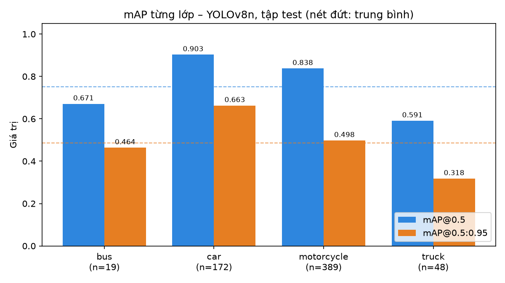
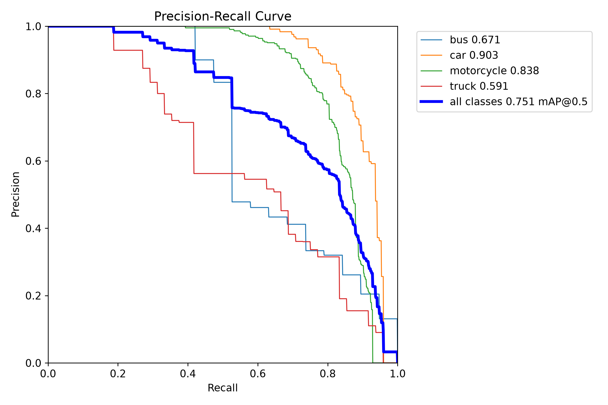
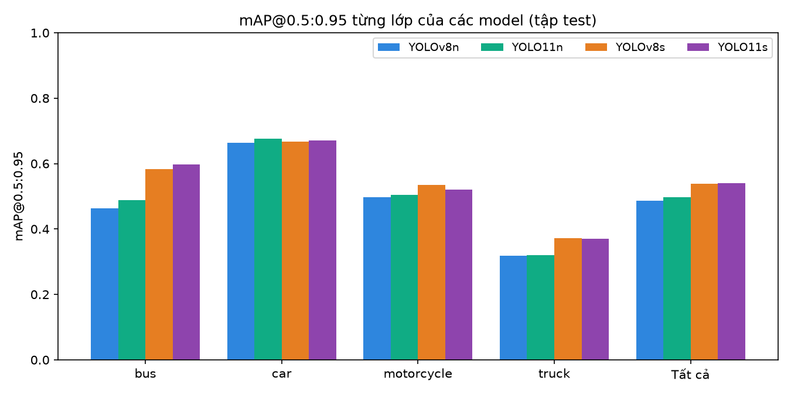
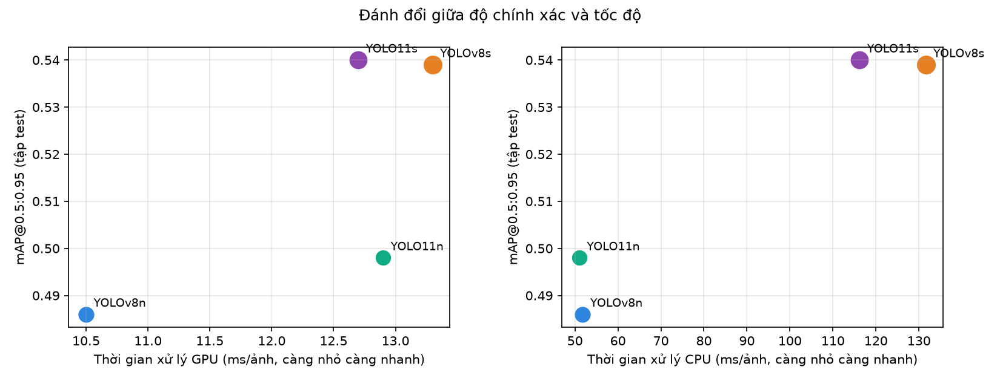

# BÁO CÁO TUẦN 7 – ĐO mAP TỪNG LỚP VÀ BẢNG ĐỐI CHUẨN HIỆU NĂNG (BENCHMARK)

- Người thực hiện: Đỗ Xuân Bách
- Ngày: 01/11/2026
- Model chính: YOLOv8n (best.pt); các model so sánh: YOLO11n, YOLOv8s, YOLO11s
- Dữ liệu: Roboflow projectdoan2 v1, 4 lớp (bus, car, motorcycle, truck); tập test 18 ảnh, tập val 39 ảnh
- Phần cứng: GPU NVIDIA GeForce RTX 3050 Laptop GPU; CPU 11th Gen Intel Core i5-11400H @ 2.70GHz

## 1. Mục tiêu

Đo chi tiết độ chính xác của model nhận diện cho từng lớp phương tiện bằng hai chỉ số chuẩn mAP@0.5 và mAP@0.5:0.95, đồng thời lập bảng đối chuẩn (benchmark) so sánh model hiện tại với các phiên bản YOLO khác về độ chính xác, tốc độ và kích thước, làm cơ sở chọn model cho bước theo dõi đối tượng (tuần 8).

## 2. Phương pháp

Các chỉ số sử dụng:

- IoU (Intersection over Union): tỉ lệ diện tích giao trên diện tích hợp giữa box dự đoán và box thật.
- Precision: tỉ lệ dự đoán đúng trong tổng số dự đoán. Recall: tỉ lệ đối tượng thật được phát hiện. F1: trung bình điều hòa của Precision và Recall. Ba chỉ số này lấy tại ngưỡng confidence cho F1 cao nhất.
- AP (Average Precision): diện tích dưới đường cong Precision–Recall của một lớp, không phụ thuộc ngưỡng confidence.
- mAP@0.5: AP trung bình các lớp, coi là đúng khi IoU ≥ 0.5. Đánh giá khả năng phát hiện đúng vật thể.
- mAP@0.5:0.95: trung bình AP ở 10 ngưỡng IoU từ 0.5 đến 0.95 (bước 0.05). Chỉ số khắt khe hơn, đánh giá cả độ chính xác vị trí box. Đây là chỉ số chính của bộ COCO.

Cách thực hiện:

- Đánh giá bằng hàm val của Ultralytics, ảnh 640×640. Tập test không tham gia train nên là kết quả chính; tập val đã được dùng để chọn epoch tốt nhất nên chỉ để tham khảo.
- Các model so sánh được train cùng cấu hình với model chính (400 epoch, patience=10, ảnh 640); model cỡ s dùng batch 8 vì GPU 4GB không đủ bộ nhớ cho batch 16.
- Tốc độ đo từ đầu đến cuối (tiền xử lý + suy luận + NMS), batch 1, lấy trung vị nhiều lượt chạy sau khi khởi động, ở định dạng PyTorch (.pt), chưa tối ưu bằng ONNX hay TensorRT.

## 3. Kết quả từng lớp của model chính (YOLOv8n)

**Bảng 1. Kết quả từng lớp – YOLOv8n, tập test**

| Lớp | Số ảnh | Số đối tượng | Precision | Recall | F1 | mAP@0.5 | mAP@0.75 | mAP@0.5:0.95 |
|---|---|---|---|---|---|---|---|---|
| bus | 10 | 19 | 0.83 | 0.474 | 0.603 | 0.671 | 0.505 | 0.464 |
| car | 18 | 172 | 0.828 | 0.837 | 0.833 | 0.903 | 0.718 | 0.663 |
| motorcycle | 18 | 389 | 0.723 | 0.807 | 0.763 | 0.838 | 0.519 | 0.498 |
| truck | 18 | 48 | 0.539 | 0.625 | 0.579 | 0.591 | 0.336 | 0.318 |
| Tất cả | 18 | 628 | 0.73 | 0.686 | 0.707 | 0.751 | 0.519 | 0.486 |

**Bảng 2. Kết quả từng lớp – YOLOv8n, tập val (tham khảo)**

| Lớp | Số ảnh | Số đối tượng | Precision | Recall | F1 | mAP@0.5 | mAP@0.75 | mAP@0.5:0.95 |
|---|---|---|---|---|---|---|---|---|
| bus | 17 | 32 | 0.818 | 0.594 | 0.688 | 0.72 | 0.685 | 0.598 |
| car | 39 | 411 | 0.925 | 0.81 | 0.864 | 0.92 | 0.743 | 0.679 |
| motorcycle | 39 | 769 | 0.841 | 0.773 | 0.806 | 0.841 | 0.541 | 0.501 |
| truck | 39 | 114 | 0.705 | 0.553 | 0.62 | 0.631 | 0.342 | 0.372 |
| Tất cả | 39 | 1326 | 0.822 | 0.682 | 0.746 | 0.778 | 0.578 | 0.538 |

*Hình 1. mAP@0.5 và mAP@0.5:0.95 từng lớp – YOLOv8n, tập test*

*Hình 2. Đường cong Precision–Recall từng lớp – YOLOv8n, tập test*

- Trên tập test, YOLOv8n đạt mAP@0.5 = 0.751 và mAP@0.5:0.95 = 0.486.
- Lớp tốt nhất là 'car' (mAP@0.5:0.95 = 0.663), lớp yếu nhất là 'truck' (0.318).
- Chênh lệch giữa mAP@0.5 và mAP@0.5:0.95 lớn nhất ở lớp 'motorcycle' (0.340): model phát hiện được đối tượng nhưng box chưa khớp chặt. Theo phân tích tuần 6, nguyên nhân chính là xe nhỏ ở xa và bị che khuất, khó khoanh chính xác.
- Kết quả trên tập val cao hơn tập test 0.052 điểm mAP@0.5:0.95, phù hợp với việc tập val đã được dùng để chọn model.
- Lớp 'bus' có dưới 30 đối tượng trong tập test nên chỉ số của lớp này dao động mạnh, cần thận trọng khi so sánh.

## 4. Bảng đối chuẩn hiệu năng các model

**Bảng 3. Độ chính xác (tập test, trừ các cột ghi val)**

| Model | Precision | Recall | mAP@0.5 | mAP@0.5:0.95 | mAP@0.5 (val) | mAP@0.5:0.95 (val) |
|---|---|---|---|---|---|---|
| YOLOv8n | 0.73 | 0.686 | 0.751 | 0.486 | 0.778 | 0.538 |
| YOLO11n | 0.82 | 0.665 | 0.762 | 0.498 | 0.8 | 0.557 |
| YOLOv8s | 0.822 | 0.672 | 0.791 | 0.539 | 0.837 | 0.592 |
| YOLO11s | 0.822 | 0.71 | 0.81 | 0.54 | 0.844 | 0.583 |

**Bảng 4. Kích thước và tốc độ xử lý (batch 1, ảnh 640)**

| Model | Tham số (triệu) | GFLOPs | Dung lượng (MB) | GPU (ms/ảnh) | FPS (GPU) | CPU (ms/ảnh) | FPS (CPU) |
|---|---|---|---|---|---|---|---|
| YOLOv8n | 3.14 | 8.8 | 6.2 | 10.5 | 95 | 51.8 | 19.3 |
| YOLO11n | 2.61 | 6.6 | 5.3 | 12.9 | 77.3 | 51 | 19.6 |
| YOLOv8s | 11.14 | 28.6 | 21.5 | 13.3 | 75.1 | 131.6 | 7.6 |
| YOLO11s | 9.43 | 21.7 | 18.3 | 12.7 | 78.6 | 116.2 | 8.6 |

**Bảng 5. Quá trình train**

| Model | Số epoch đã chạy | Epoch tốt nhất | Thời gian train (phút) |
|---|---|---|---|
| YOLOv8n | 40 | 30 | 1.8 |
| YOLO11n | 73 | 64 | 3.9 |
| YOLOv8s | 63 | 53 | 4.9 |
| YOLO11s | 60 | 50 | 4.8 |

**Bảng 6. mAP@0.5 từng lớp của các model (tập test)**

| Lớp | YOLOv8n | YOLO11n | YOLOv8s | YOLO11s |
|---|---|---|---|---|
| bus | 0.671 | 0.697 | 0.741 | 0.829 |
| car | 0.903 | 0.93 | 0.926 | 0.919 |
| motorcycle | 0.838 | 0.848 | 0.875 | 0.848 |
| truck | 0.591 | 0.573 | 0.621 | 0.644 |
| Tất cả | 0.751 | 0.762 | 0.791 | 0.81 |

**Bảng 7. mAP@0.5:0.95 từng lớp của các model (tập test)**

| Lớp | YOLOv8n | YOLO11n | YOLOv8s | YOLO11s |
|---|---|---|---|---|
| bus | 0.464 | 0.489 | 0.583 | 0.597 |
| car | 0.663 | 0.677 | 0.667 | 0.671 |
| motorcycle | 0.498 | 0.505 | 0.534 | 0.521 |
| truck | 0.318 | 0.32 | 0.372 | 0.371 |
| Tất cả | 0.486 | 0.498 | 0.539 | 0.54 |

*Hình 3. mAP@0.5:0.95 từng lớp của các model (tập test)*

*Hình 4. Đánh đổi giữa độ chính xác và tốc độ*

- YOLO11s có mAP@0.5:0.95 cao nhất (0.540), hơn YOLOv8n 5.4 điểm phần trăm, với số tham số gấp 3.0 lần.
- Trên GPU NVIDIA GeForce RTX 3050 Laptop GPU, model nhanh nhất là YOLOv8n (10.5 ms/ảnh ≈ 95.0 FPS). Tất cả model đều đạt từ 75.1 FPS trở lên.
- Trên GPU, thời gian xử lý của các model chênh nhau ít (10.5–13.3 ms/ảnh) dù số phép tính chênh tới 4.3 lần. Lý do: khi xử lý từng ảnh một, phần tiền xử lý, NMS và chi phí gọi GPU chiếm phần lớn thời gian, nên thứ tự nhanh/chậm giữa các model trên GPU có thể đổi giữa các lần đo. Trên CPU, tốc độ tỉ lệ rõ với GFLOPs.
- Trên CPU, model nhanh nhất là YOLO11n (51.0 ms/ảnh ≈ 19.6 FPS); các model cỡ s chỉ đạt 7.6–8.6 FPS.
- Lớp được cải thiện nhiều nhất khi đổi model là 'bus' (+0.133 mAP@0.5:0.95 với YOLO11s).

## 5. Kết luận và đề xuất

- Nếu chạy trên GPU: nên dùng YOLO11s cho bước tracking ở tuần 8. Model này đạt 78.6 FPS (vẫn ≥ 30 FPS) và mAP@0.5:0.95 0.540 so với 0.486 của YOLOv8n. Độ chính xác cao hơn giúp tracking ổn định hơn (ít mất dấu, ít đổi ID).
- YOLOv8s có mAP@0.5:0.95 gần như bằng YOLO11s (chênh dưới 0.01, trong phạm vi sai số của tập test 18 ảnh), nên cũng là lựa chọn tương đương.
- Nếu phải chạy trên CPU: dùng YOLO11n (19.6 FPS, là model chính xác nhất trong nhóm đạt ≥ 15 FPS).
- Lớp 'truck' yếu nhất ở 4/4 model (mAP@0.5:0.95 cao nhất chỉ đạt 0.372). Đổi model không giải quyết hết vấn đề; cần bổ sung dữ liệu cho lớp này (xem đề xuất ở báo cáo tuần 6).
- Tất cả model đều dừng sớm do patience=10. Có thể train lại với patience 30–50 để so sánh ở mức hội tụ đầy đủ.

## 6. Hạn chế và lưu ý

### 6.1. Hạn chế

- Tập test chỉ có 18 ảnh nên chênh lệch nhỏ giữa các model (dưới khoảng 0.02 mAP) có thể chỉ là do ngẫu nhiên.
- Mỗi model chỉ train một lần; train lại với seed khác có thể cho kết quả hơi khác.
- Model cỡ s dùng batch 8 thay vì 16 do giới hạn bộ nhớ GPU.
- Tốc độ đo trên laptop nên phụ thuộc chế độ nguồn và nhiệt độ máy; đo ở định dạng PyTorch, chưa tối ưu.

### 6.2. Lưu ý khi đọc và tái lập kết quả

- Tốc độ dao động giữa các lần đo: qua 4 lần chạy thử, YOLOv8n đạt từ khoảng 78 đến 98 FPS trên GPU và 15–19 FPS trên CPU (chênh 20–25%), do laptop thay đổi xung nhịp theo nhiệt độ và chế độ nguồn. Số liệu trong bảng là của một lần đo. Vì vậy chỉ nên xem thứ tự gần đúng, không nên dựa vào chênh lệch vài FPS. Riêng khoảng cách giữa model cỡ n và cỡ s trên CPU (khoảng 2–3 lần) là ổn định qua các lần đo.
- Cả 4 model đều giữ patience=10 như cấu hình gốc để so sánh công bằng, nên đều dừng sớm (40–73 epoch trên tối đa 400).
- Precision và Recall ở bảng benchmark lấy tại ngưỡng confidence cho F1 cao nhất, nên khác với Precision/Recall trong báo cáo tuần 6 (ngưỡng cố định 0.25). mAP không phụ thuộc ngưỡng nên so sánh được giữa hai báo cáo.
- YOLOv8n ở đây là cùng một model với báo cáo tuần 6 (best.pt).
- Các model được lưu trong thư mục models/ ở gốc dự án: best.pt (YOLOv8n), yolo11n_best.pt (YOLO11n), yolov8s_best.pt (YOLOv8s), yolo11s_best.pt (YOLO11s). Log train của các model so sánh nằm ở runs/bench_<tên model>/.
- Cách chạy lại: mở tuan7/tuần 7.ipynb trong VS Code, chọn kernel .venv của dự án rồi Run all. Model nào đã có trong models/ thì notebook bỏ qua bước train, chỉ đo lại (vài phút); muốn train lại model nào thì xóa file tương ứng. Vì vậy output đã lưu trong notebook có thể không còn log train.

## Phụ lục: file đi kèm

- output/benchmark.csv
- output/do_chinh_xac_vs_toc_do.png
- output/map50_95_tung_lop_cac_model.csv
- output/map50_tung_lop_cac_model.csv
- output/map_tung_lop.png
- output/map_tung_lop_cac_model.png
- output/tung_lop_YOLOv8n_test.csv
- output/tung_lop_YOLOv8n_val.csv
- output/val/<model>_<tập>/ – kết quả val gốc của Ultralytics (confusion matrix, đường cong P/R/F1)
